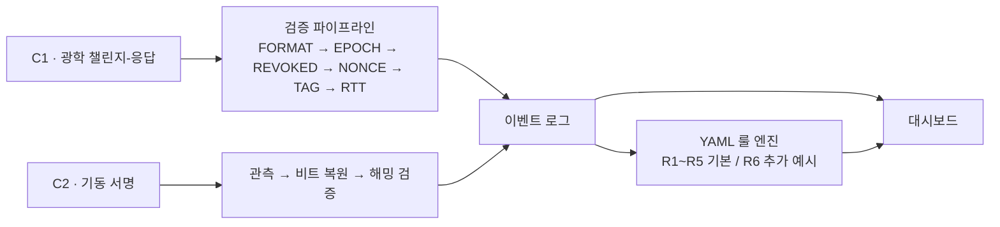
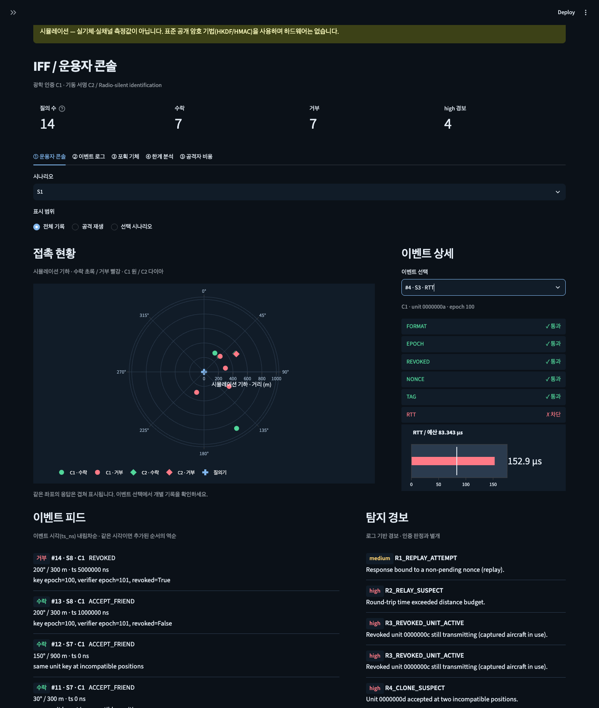
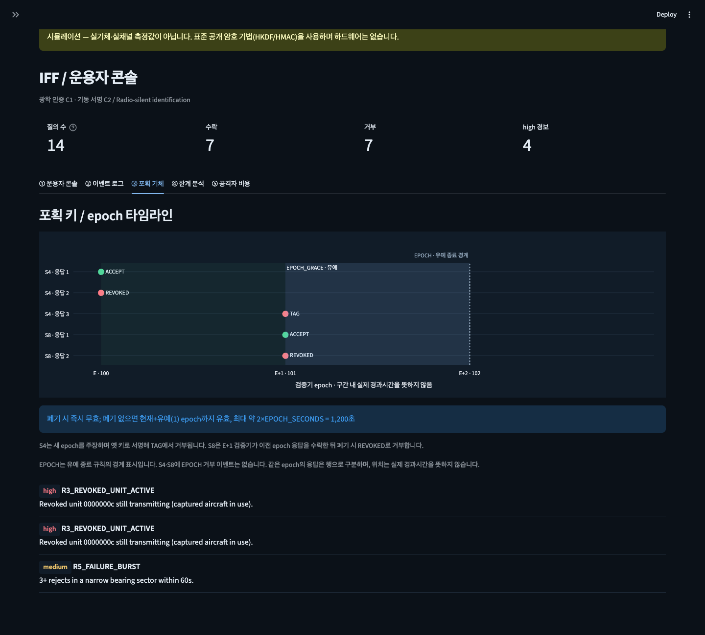

# Radio-silent IFF

광학 챌린지-응답(C1)과 기동 서명(C2)으로 공격 내성을 재현하는 2-컴포넌트 피아식별 시뮬레이션.

**D4D x EDTH · Korean Defense Tech Hackathon · Track 1 / Problem 04**

> **시뮬레이션입니다.** 실기체·실채널·실측값이 없습니다. 표준 공개 암호 기법
> (HKDF-SHA256, HMAC-SHA256, nonce 챌린지-응답)을 사용하며 Python으로 동작합니다.
> 아래 결과는 시뮬레이션의 판정이며 실제 운용 성능을 뜻하지 않습니다.

## 결과 한눈에

기본 시드 42 기준입니다. `ACCEPT_FRIEND`는 수락을 뜻하며, 차단 시 첫 실패 단계를 기록합니다.

| 시나리오 | 공격 / 상황 | 차단 단계 / 결과 | 근거 테스트 파일 |
|---|---|---|---|
| S1 | 정상 아군 | ACCEPT_FRIEND | [test_protocol.py](tests/test_protocol.py) |
| S2 | 과거 응답 재전송 | 정상 교신 수락 → NONCE | [test_protocol.py](tests/test_protocol.py), [test_scenarios.py](tests/test_scenarios.py) |
| S3 | 중계 MITM | RTT (예산 초과) | [test_protocol.py](tests/test_protocol.py), [test_scenarios.py](tests/test_scenarios.py) |
| S4 | 포획 기체의 유효 키 사용 | 수락 → 폐기 후 REVOKED → 새 epoch를 주장하며 옛 키로 서명하면 TAG | [test_scenarios.py](tests/test_scenarios.py) |
| S5 | 무작위 태그 위조 | TAG | [test_protocol.py](tests/test_protocol.py), [test_scenarios.py](tests/test_scenarios.py) |
| S6 | 이전 window 기동 재현 | 정상 기동 수락 → C2_HAMMING | [test_maneuver.py](tests/test_maneuver.py), [test_scenarios.py](tests/test_scenarios.py) |
| S7 | 같은 키로 서로 양립 불가능한 위치에서 응답 | 두 응답 모두 수락; 로그에서 R4_CLONE_SUSPECT 경보 | [test_scenarios.py](tests/test_scenarios.py) |
| S8 | 포획 키의 유예와 폐기 | E+1에서 이전 epoch 키 수락 → 같은 유예 구간에서 폐기 후 REVOKED | [test_s8_grace.py](tests/test_s8_grace.py) |

## 구조



C1은 지향성 광학 질의에 응답하고, C2는 기동을 수동 관측합니다.
C2의 해밍 검증과 C1의 6단계 검증은 별도 경로이며 결과를 같은 이벤트 로그에 기록합니다.
경보는 인증 판정과 별개입니다. R1은 재전송, R2는 중계 의심, R3은 폐기 기체 활동,
R4는 복제 의심, R5는 실패 폭주를 탐지합니다.
R6은 오래된 epoch 응답의 반복을 탐지하는 추가 예시입니다.
`python3 scripts/demo_r6.py`로 시연할 수 있습니다. [룰 설명](rules/README.md)

## 스크린샷





## Quickstart

저장소 루트에서 실행합니다.

```bash
python3 -m pip install -r requirements.txt
python3 -m pytest -q
python3 scripts/run_all.py --seed 42
python3 -m streamlit run app.py
```

한계 분석 자료는 `python3 scripts/sweep_noise.py`로 생성합니다.
시나리오 실행 결과는 `out/events.jsonl`, `out/summary.csv`에 저장됩니다.

## 공격자 비용

아래는 기본 설정에서 `python3 scripts/sweep_noise.py`로 생성한
`attacker_cost` 데이터입니다. 확률은 명시된 조건 아래의 값이며, 실측 운용 비용은 미측정입니다.
출처의 CSV 파일은 `out/`에 생성됩니다. [유도와 출처 상세](docs/attacker_cost.md)

| 공격 | 조건 | 성공 확률 | 필요 역량 | 유효 시간 | 출처 |
|---|---|---:|---|---|---|
| S2 재전송 | 이미 소비된 nonce | 0 | 이전 응답을 관측·저장하고 재송신할 역량 | 소비된 nonce의 유효 시간은 0초; 미소비 질의의 시간 제한은 미측정(TTL 미구현) | iff/config.py:NONCE_BYTES; iff/protocol.py:Interrogator.verify NONCE; iff/scenarios.py:s2_replay |
| S3 중계 MITM | 추가 지연 0µs | 1 | 질의를 아군에 전달하고 유효 응답을 낮은 지연으로 중계할 역량 | 미측정: 새 nonce 질의에 대한 응답 시간 창(TTL 미구현) | relay_sweep.csv:relay_overhead_ns,reject_rate,budget_ns,nominal_rtt_ns; scripts/sweep_noise.py:relay_sweep; iff/config.py:rtt_budget_ns |
| S3 중계 MITM | 추가 지연 10µs | 1 | 질의를 아군에 전달하고 유효 응답을 낮은 지연으로 중계할 역량 | 미측정: 새 nonce 질의에 대한 응답 시간 창(TTL 미구현) | relay_sweep.csv:relay_overhead_ns,reject_rate,budget_ns,nominal_rtt_ns; scripts/sweep_noise.py:relay_sweep; iff/config.py:rtt_budget_ns |
| S3 중계 MITM | 추가 지연 20µs | 1 | 질의를 아군에 전달하고 유효 응답을 낮은 지연으로 중계할 역량 | 미측정: 새 nonce 질의에 대한 응답 시간 창(TTL 미구현) | relay_sweep.csv:relay_overhead_ns,reject_rate,budget_ns,nominal_rtt_ns; scripts/sweep_noise.py:relay_sweep; iff/config.py:rtt_budget_ns |
| S3 중계 MITM | 추가 지연 30µs | 0.595 | 질의를 아군에 전달하고 유효 응답을 낮은 지연으로 중계할 역량 | 미측정: 새 nonce 질의에 대한 응답 시간 창(TTL 미구현) | relay_sweep.csv:relay_overhead_ns,reject_rate,budget_ns,nominal_rtt_ns; scripts/sweep_noise.py:relay_sweep; iff/config.py:rtt_budget_ns |
| S3 중계 MITM | 추가 지연 40µs | 0 | 질의를 아군에 전달하고 유효 응답을 낮은 지연으로 중계할 역량 | 미측정: 새 nonce 질의에 대한 응답 시간 창(TTL 미구현) | relay_sweep.csv:relay_overhead_ns,reject_rate,budget_ns,nominal_rtt_ns; scripts/sweep_noise.py:relay_sweep; iff/config.py:rtt_budget_ns |
| S3 중계 MITM | 추가 지연 60µs | 0 | 질의를 아군에 전달하고 유효 응답을 낮은 지연으로 중계할 역량 | 미측정: 새 nonce 질의에 대한 응답 시간 창(TTL 미구현) | relay_sweep.csv:relay_overhead_ns,reject_rate,budget_ns,nominal_rtt_ns; scripts/sweep_noise.py:relay_sweep; iff/config.py:rtt_budget_ns |
| S3 중계 MITM | 추가 지연 100µs | 0 | 질의를 아군에 전달하고 유효 응답을 낮은 지연으로 중계할 역량 | 미측정: 새 nonce 질의에 대한 응답 시간 창(TTL 미구현) | relay_sweep.csv:relay_overhead_ns,reject_rate,budget_ns,nominal_rtt_ns; scripts/sweep_noise.py:relay_sweep; iff/config.py:rtt_budget_ns |
| S3 중계 MITM | 추가 지연 200µs | 0 | 질의를 아군에 전달하고 유효 응답을 낮은 지연으로 중계할 역량 | 미측정: 새 nonce 질의에 대한 응답 시간 창(TTL 미구현) | relay_sweep.csv:relay_overhead_ns,reject_rate,budget_ns,nominal_rtt_ns; scripts/sweep_noise.py:relay_sweep; iff/config.py:rtt_budget_ns |
| S4 포획 기체 | 폐기 전·현재/유예 epoch | 1 | 해당 기체의 유효 epoch/unit 키 확보 및 정상 응답 생성 역량 | 폐기 시 즉시 무효; 폐기 없으면 현재+유예(1) epoch까지 유효, 최대 약 2×EPOCH_SECONDS = 1,200초 | iff/config.py:EPOCH_SECONDS,EPOCH_GRACE; iff/protocol.py:Interrogator.verify EPOCH/REVOKED/TAG; iff/scenarios.py:s8_captured_key_grace |
| S4 포획 기체 | 폐기 후 | 0 | 해당 기체의 유효 epoch/unit 키 확보 및 정상 응답 생성 역량 | 폐기 시 즉시 무효; 폐기 없으면 현재+유예(1) epoch까지 유효, 최대 약 2×EPOCH_SECONDS = 1,200초 | iff/config.py:EPOCH_SECONDS,EPOCH_GRACE; iff/protocol.py:Interrogator.verify EPOCH/REVOKED/TAG; iff/scenarios.py:s8_captured_key_grace |
| S5 무작위 위조 | 시도당 균등 태그 추측 | 2.3283064e-10 | 공개 질의 nonce를 수신하고 형식에 맞는 응답·무작위 태그를 송신할 역량 | 미측정: 미소비 nonce 질의 동안 시도(TTL·시도 빈도 미구현) | iff/config.py:TAG_BITS; iff/crypto.py:response_tag; iff/attacks.py:forge |
| S6 기동 재현 | 편대 1대 | 0.0020904541 | 이전 기동을 관측·기록하고 비트 패턴에 대응하는 미세 기동을 재현할 역량 | 현재 패턴 window의 남은 시간 ≤ 60초; 다음 window는 새 패턴 | list_size.csv:fleet_size,analytic_any_false_match,per_unit_prob; iff/maneuver.py:random_match_prob; iff/config.py:MANEUVER_BITS,MANEUVER_HAMMING_K,MANEUVER_WINDOW_S |
| S6 기동 재현 | 편대 5대 | 0.010408662 | 이전 기동을 관측·기록하고 비트 패턴에 대응하는 미세 기동을 재현할 역량 | 현재 패턴 window의 남은 시간 ≤ 60초; 다음 window는 새 패턴 | list_size.csv:fleet_size,analytic_any_false_match,per_unit_prob; iff/maneuver.py:random_match_prob; iff/config.py:MANEUVER_BITS,MANEUVER_HAMMING_K,MANEUVER_WINDOW_S |
| S6 기동 재현 | 편대 10대 | 0.020708983 | 이전 기동을 관측·기록하고 비트 패턴에 대응하는 미세 기동을 재현할 역량 | 현재 패턴 window의 남은 시간 ≤ 60초; 다음 window는 새 패턴 | list_size.csv:fleet_size,analytic_any_false_match,per_unit_prob; iff/maneuver.py:random_match_prob; iff/config.py:MANEUVER_BITS,MANEUVER_HAMMING_K,MANEUVER_WINDOW_S |
| S6 기동 재현 | 편대 25대 | 0.050971125 | 이전 기동을 관측·기록하고 비트 패턴에 대응하는 미세 기동을 재현할 역량 | 현재 패턴 window의 남은 시간 ≤ 60초; 다음 window는 새 패턴 | list_size.csv:fleet_size,analytic_any_false_match,per_unit_prob; iff/maneuver.py:random_match_prob; iff/config.py:MANEUVER_BITS,MANEUVER_HAMMING_K,MANEUVER_WINDOW_S |
| S6 기동 재현 | 편대 50대 | 0.099344194 | 이전 기동을 관측·기록하고 비트 패턴에 대응하는 미세 기동을 재현할 역량 | 현재 패턴 window의 남은 시간 ≤ 60초; 다음 window는 새 패턴 | list_size.csv:fleet_size,analytic_any_false_match,per_unit_prob; iff/maneuver.py:random_match_prob; iff/config.py:MANEUVER_BITS,MANEUVER_HAMMING_K,MANEUVER_WINDOW_S |
| S6 기동 재현 | 편대 100대 | 0.18881912 | 이전 기동을 관측·기록하고 비트 패턴에 대응하는 미세 기동을 재현할 역량 | 현재 패턴 window의 남은 시간 ≤ 60초; 다음 window는 새 패턴 | list_size.csv:fleet_size,analytic_any_false_match,per_unit_prob; iff/maneuver.py:random_match_prob; iff/config.py:MANEUVER_BITS,MANEUVER_HAMMING_K,MANEUVER_WINDOW_S |
| S6 기동 재현 | 편대 200대 | 0.34198558 | 이전 기동을 관측·기록하고 비트 패턴에 대응하는 미세 기동을 재현할 역량 | 현재 패턴 window의 남은 시간 ≤ 60초; 다음 window는 새 패턴 | list_size.csv:fleet_size,analytic_any_false_match,per_unit_prob; iff/maneuver.py:random_match_prob; iff/config.py:MANEUVER_BITS,MANEUVER_HAMMING_K,MANEUVER_WINDOW_S |

S4의 폐기 전 1은 유효 키·새 nonce·허용 RTT를 모두 갖춘 조건부 수락입니다.
S3은 기준 거리 400m, 시드 42, 지연별 200회 시뮬레이션이며 단일 종합 성공률은 미측정입니다.
S6은 독립·균등 패턴 가정의 해석적 오수락이며, 특정 재현 실험의 성공률이 아닙니다.
유도할 근거가 없는 값은 미측정이며 0을 뜻하지 않습니다.

## 가정과 한계

**측정하지 않은 가정값** ([iff/config.py](iff/config.py))

- `ASSUMPTION_PROC_NS = 50 µs`: 응답기 처리 지연.
- `ASSUMPTION_PROC_JITTER_NS = 5 µs`: 처리 지연 지터.
- `ASSUMPTION_PROC_MAX_NS = 70 µs`: RTT 검증에 허용한 처리 성분.

**설계상 한계**

- **거리 검증**: 기본 중계 분석의 명목 탐지 경계는 RTT 예산 − 기본 왕복 ≈ 30.674µs
  (약 31µs)입니다. 명목 경계는 지터와 무관하며 경계 주변 성공률은 지터의 영향을 받습니다.
  `out/relay_sweep.csv`의 지연별 성공률은 `1 − reject_rate`입니다.
- **포획 키 유효 구간**: 폐기하면 즉시 무효입니다. 폐기하지 않으면 현재와 유예
  (`EPOCH_GRACE=1`) epoch까지, 최대 약 `2×EPOCH_SECONDS = 1,200초` 동안 유효합니다.
  해당 epoch 키만 보유하고 새 키를 받지 않으며 epoch가 정상 회전한다는 조건입니다.
  코드는 벽시계로 epoch를 자동 회전시키지 않습니다. S4의 TAG 거부는 새 epoch를
  주장하며 옛 키로 서명한 경우입니다. 이전 epoch를 제시하는 유예 수락과 즉시 폐기는 S8에서 확인합니다.
- **C2 목록 크기**: C2는 관측을 아군 목록 전체와 대조하므로 목록이 커질수록
  오수락 확률이 올라갑니다(`out/list_size.csv`). C2 단독 식별은 소규모 편대를
  전제로 하며 대규모·고신뢰 식별에는 C1 확인이 필요합니다.
- **C2 노이즈 민감도**: 관측 σ가 커지면 정상 아군 수락률이 떨어집니다(`out/roc.csv`).
  이전 window 재현의 거부는 S6의 조건에서 확인하는 결과이며, 모든 노이즈 조건에서의 거부를 보장하지 않습니다.
- 광학·음향 채널의 물리 계층은 모델링하지 않았습니다. 프로토콜은 채널 독립적입니다.

## S9 상호 인증 확장

기존 S1~S8 판정과 응답 검증 명세는 유지합니다. `Interrogator.issue()`는
`iq_key = HKDF(epoch_key, b"iff-iq", b"")`로 파생한 키로
`iq_tag = trunc32(HMAC-SHA256(iq_key, b"CQ" ‖ nonce ‖ interrogator_id ‖ epoch))`를
자동 첨부합니다. ID는 UTF-8, epoch는 8바이트 big-endian입니다. 태그로 **질의 +4바이트**입니다.
드론에는 해당 epoch의 iq_key와 자신의 unit_key만 배포합니다.

응답기는 현재 epoch만 허용하며(질의에는 유예 없음), 태그 불일치·epoch 범위 밖·
같은 epoch의 이미 처리한 nonce에서 무응답입니다. `CQ` 응답기 로컬 이벤트로
`NO_RESPONSE`와 `IQ_TAG` / `IQ_EPOCH` / `IQ_NONCE` 원인을 기록합니다.
이 기록은 무선 응답이 아니며, 대시보드에서 회색 X와 무응답 피드로 표시합니다.

| 시나리오 | 입력 | 기대 결과 |
|---|---|---|
| S9a | 키 없는 가짜 질의기 | NO_RESPONSE / IQ_TAG |
| S9b | 같은 드론이 처리한 진짜 질의 재방송 | NO_RESPONSE / IQ_NONCE |

R7은 `rules/07-rogue-interrogator.yaml`만으로 이 무응답 기록을 탐지합니다.
CLI와 대시보드는 S9를 포함합니다. 기존 API의 기본 실행 집합은 보존하며,
`run_all(include_grace=True, include_rogue=True)`로 S1~S9를 실행합니다.

| 공격자 비용 | 성공 확률 | 필요 역량 | 한계 |
|---|---:|---|---|
| S9a 질의 태그 추측 | 시도당 2^-32 | 질의 송신과 균등 32비트 태그 추측 | 반복 시도 빈도 미측정 |
| S9b 소비한 질의 재방송 | 0 | 진짜 질의 녹화·재송신 | 같은 응답기·epoch·보존된 nonce 캐시 조건 |

**포획 드론에서 iq_key 유출 시 해당 epoch 동안 가짜 질의가 가능합니다.**
공유 iq_key 폐기·교체와 다음 epoch 키 배포 제외로 제한해야 합니다.
unit ID 폐기만으로 공유 질의 키를 무효화할 수는 없습니다.
nonce 캐시는 프로세스 메모리에 있으므로 재시작 시의 영속 보존은 운용 계층 책임입니다.
응답기가 처음 보는 녹화 질의는 캐시만으로 구분할 수 없습니다.

## 해커톤 기간 신규 개발 범위

프로토콜, 검증 파이프라인, 채널·기동 모델, 공격 시나리오, 탐지 룰, 대시보드,
테스트를 본 해커톤 기간에 신규 개발했습니다. 기존 코드·사전 작업물은 없습니다.

[MIT License](LICENSE) · [시연 안내](DEMO.md)

## LLM 경보 브리핑

운용자 콘솔 맨 위의 **상황 브리핑**은 기존 경보를 해석합니다.
**LLM은 판정에 관여하지 않는다.** 식별·룰 엔진·시나리오·기대값에는 연결되지 않으며,
이벤트 ID, unit_id, reject_stage, 경보 룰과 심각도만 JSON으로 전송합니다.
[OpenAI Structured Outputs](https://developers.openai.com/api/docs/guides/structured-outputs?api-mode=chat)로
`{summary, findings:[{text, evidence_event_ids, rule}], recommendations:[...]}` 응답을 받습니다.

Streamlit Community Cloud의 앱 Settings → Secrets 또는 로컬 `.streamlit/secrets.toml`에 설정하세요.
아래 키 값은 설명용 자리표시자입니다. 실제 키를 소스나 커밋에 넣지 마세요.

```toml
OPENAI_API_KEY = "YOUR_API_KEY"
OPENAI_MODEL = "gpt-4o-mini"
```

동일 이름의 환경변수도 지원하며 Secrets가 우선합니다. 모델 기본값은 `gpt-4o-mini`입니다.
키와 `.env` 파일은 gitignore 대상입니다. 키는 캐시 인자나 로그에 기록하지 않습니다.
컨텍스트 SHA-256 해시와 모델별 `st.cache_data` 메모리 캐시(최대 128개)를 사용합니다.
같은 컨텍스트는 캐시 유지 중 재호출하지 않으며, 실패 결과도 캐시합니다.
모델 변경·캐시 초기화·서버 재시작·캐시 항목 퇴출 후에는 다시 호출될 수 있습니다.

각 finding의 이벤트 ID·실제 경보 룰·텍스트 속 unit_id를 결정론적으로 검사합니다.
기체 언급은 `unit_id=<ID>` 형식을 사용하며 8자리 hex 단독 언급도 검사합니다.
실패한 finding은 **근거 없음**과 회색 취소선으로 표시됩니다. 근거 ID를 누르면 기존 상세 패널이 선택됩니다.
검증 n/m은 참조 존재 여부이며 해석의 의미적 정확성 보증은 아닙니다. 요약·권고는 집계 밖입니다.
기존 경보 근거가 타임스탬프이므로 중복 시각은 복수 이벤트 후보로 전달됩니다.

키가 없거나 API 호출·응답 검증이 실패하면 `docs/sample_brief.json`을 **캐시된 예시**로 표시합니다.
이는 seed=42 전체 로그에서 오프라인으로 생성한 예시이며 실시간 LLM 응답으로 가장하지 않습니다.
예시도 현재 표시 로그로 재검증하므로 다른 시나리오나 시드에서는 근거 없음이 표시될 수 있습니다.
생성·검증은 네트워크 없이 재현됩니다:

```bash
python3 scripts/make_sample_brief.py
python3 -m pytest -q
```
