# Radio-silent IFF

광학 챌린지-응답(C1)과 기동 서명(C2)으로 공격 내성을 재현하는 2-컴포넌트 피아식별 시뮬레이션.

**D4D x EDTH · Korean Defense Tech Hackathon · Track 1 / Problem 04**

## 3분 데모 가이드

1. **0:00–1:30 · ① 3분 가이드 투어**를 누르고 **다음 / 이전**으로 9개 장면을 봅니다.
   문제 → C1·C2 구조 → 정상 아군 → 재전송·위조 → 중계 RTT → 포획·유예 → 가짜 질의기 침묵
   → 직접 공격 → 정직한 한계 순서입니다. 레이더·파이프라인·타임라인은 기존 엔진 실행 결과입니다.
2. **1:30–2:20 · ② 공격 실험에서 직접 공격**을 누릅니다. 네 프리셋은 클릭 즉시 입력을 채우고 실행합니다.
   **중계 25µs**, **중계 40µs**, **포획 기체 미폐기**, **가짜 질의기**를 차례로 비교하세요.
   첫 진입에도 첫 프리셋 결과가 표시됩니다. 수락된 공격은 **알려진 한계**로 명시합니다.
3. **2:20–3:00 · ③ 한계 분석 확인**에서 RTT·관측 노이즈·목록 크기의 영향을 확인합니다.
   시간이 남으면 **공격 실험 → 샌드박스 심화**에서 지연 경계, 폐기 시점, 두 설정의 파이프라인을 비교하세요.

**운용자 질문**은 콘솔 아래에 있습니다. 예시 답변은 키 없이 볼 수 있으며 모든 문장에 이벤트 ID가 붙습니다.
**교전 트래픽**에서는 시간 스크러버로 레이더·경보를 되돌리고, 룰별 막대와 BER 오탐 곡선을 함께 봅니다.

**[2분 데모 영상 보기 · WebM](docs/media/walkthrough.webm)** — 프로토콜 재생 → 9장면 투어 → 중계 25µs/40µs 비교 → 브리핑 근거 검증 → 한계 분석.
영상의 LLM 구간은 화면에 명시된 오프라인 예시를 현재 엔진 로그로 다시 검증합니다.

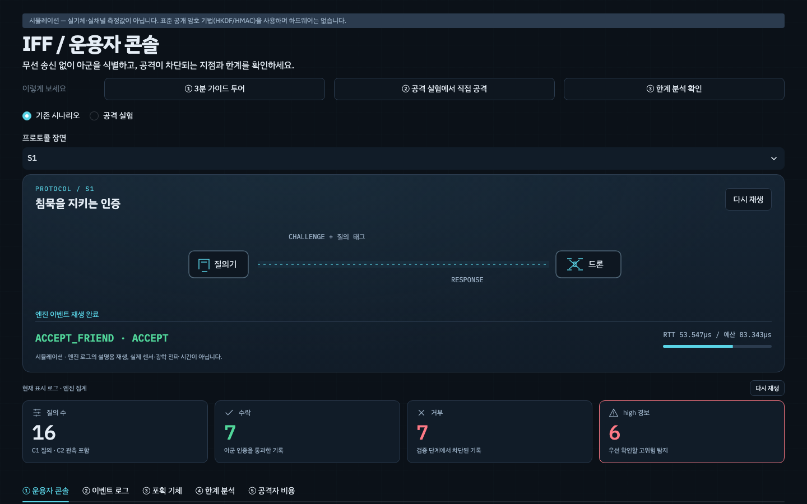

프로토콜·검증 관문·SVG 레이더·KPI의 **다시 재생** 버튼으로 장면을 반복할 수 있습니다.
시스템의 모션 감소 설정에서는 최종 정지 화면을 표시합니다. 레이더 스윕은 장식이며 실제 센서가 아닙니다.
경보 링은 룰의 타임스탬프 근거를 표시하므로 같은 시각의 기록은 함께 강조될 수 있습니다.

> **시뮬레이션입니다.** 실기체·실채널·실측값이 없습니다. 표준 공개 암호 기법
> (HKDF-SHA256, HMAC-SHA256, nonce 챌린지-응답)을 사용하며 Python으로 동작합니다.
> 아래 결과는 시뮬레이션의 판정이며 실제 운용 성능을 뜻하지 않습니다.

## 결과 한눈에

기본 시드 42 기준입니다. `ACCEPT_FRIEND`는 수락을 뜻하며, 차단 시 첫 실패 단계를 기록합니다.

| 시나리오 | 공격 / 상황 | 차단 단계 / 결과 | 근거 테스트 파일 |
|---|---|---|---|
| S1 | 정상 아군 | ACCEPT_FRIEND | [test_protocol.py](tests/test_protocol.py) |
| S2 | 과거 응답 재전송 | 정상 교신 수락 → NONCE | [test_protocol.py](tests/test_protocol.py), [test_scenarios.py](tests/test_scenarios.py) |
| S3 | 중계 MITM | RTT (예산 초과) | [test_protocol.py](tests/test_protocol.py), [test_scenarios.py](tests/test_scenarios.py) |
| S4 | 포획 기체의 유효 키 사용 | 수락 → 폐기 후 REVOKED → 새 epoch를 주장하며 옛 키로 서명하면 TAG | [test_scenarios.py](tests/test_scenarios.py) |
| S5 | 무작위 태그 위조 | TAG | [test_protocol.py](tests/test_protocol.py), [test_scenarios.py](tests/test_scenarios.py) |
| S6 | 이전 window 기동 재현 | 정상 기동 수락 → C2_HAMMING | [test_maneuver.py](tests/test_maneuver.py), [test_scenarios.py](tests/test_scenarios.py) |
| S7 | 같은 키로 서로 양립 불가능한 위치에서 응답 | 두 응답 모두 수락; 로그에서 R4_CLONE_SUSPECT 경보 | [test_scenarios.py](tests/test_scenarios.py) |
| S8 | 포획 키의 유예와 폐기 | E+1에서 이전 epoch 키 수락 → 같은 유예 구간에서 폐기 후 REVOKED | [test_s8_grace.py](tests/test_s8_grace.py) |

## 구조

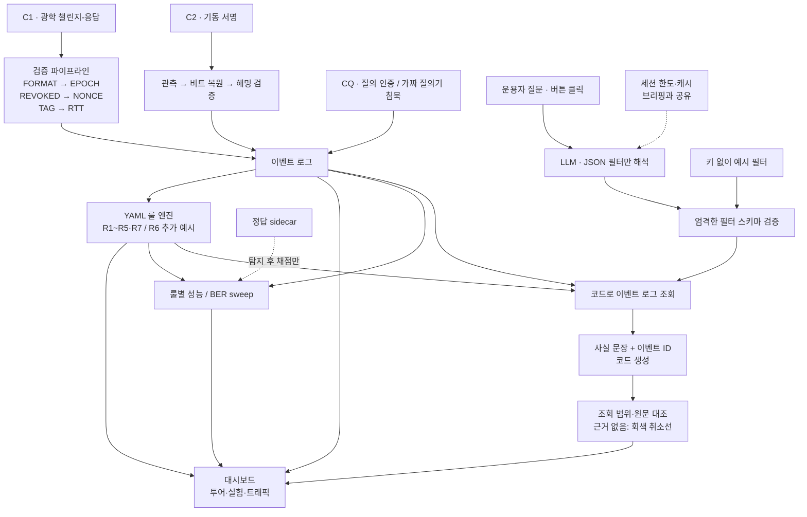

C1은 지향성 광학 질의에 응답하고, C2는 기동을 수동 관측합니다.
C2의 해밍 검증과 C1의 6단계 검증은 별도 경로이며 결과를 같은 이벤트 로그에 기록합니다.
경보는 인증 판정과 별개입니다. R1은 재전송, R2는 중계 의심, R3은 폐기 기체 활동,
R4는 복제 의심, R5는 실패 폭주를 탐지합니다.
R6은 오래된 epoch 응답의 반복을 탐지하는 추가 예시입니다.
`python3 scripts/demo_r6.py`로 시연할 수 있습니다. [룰 설명](rules/README.md)
R7은 응답기의 무응답 로컬 기록에서 가짜·재방송 질의를 탐지합니다.
LLM 경로는 판정 엔진으로 되돌아가지 않습니다. 스키마 검증된 필터로만 로그를 조회하고,
답변 문장과 인용 ID를 해당 조회 결과에 대조합니다. 정답 라벨은 탐지기에 전달하지 않습니다.

## 스크린샷

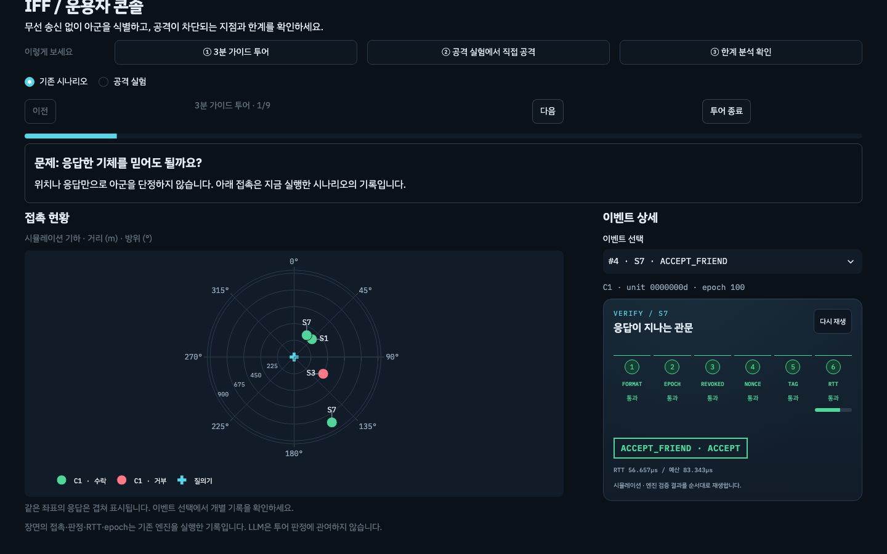

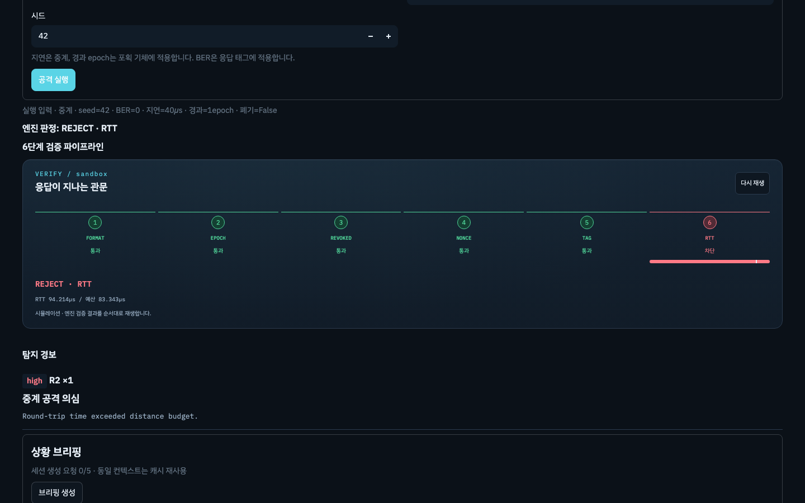

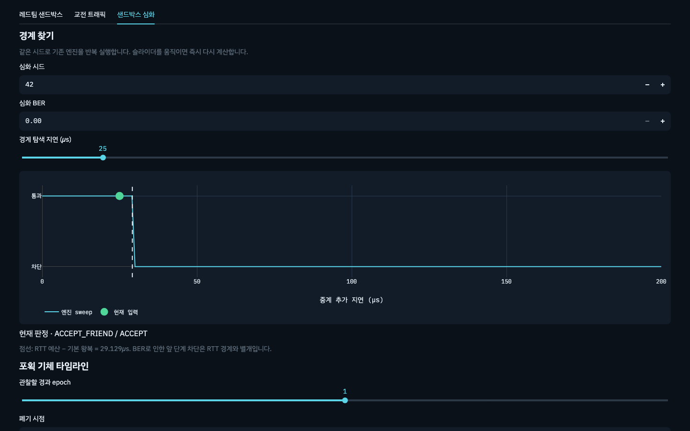

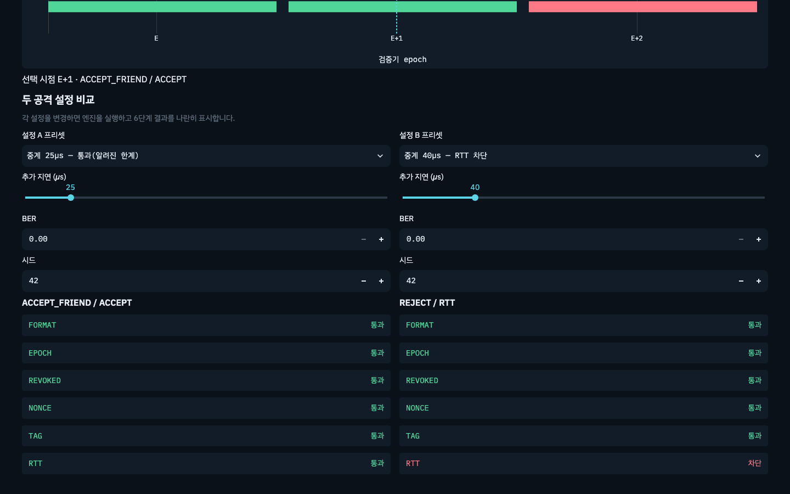

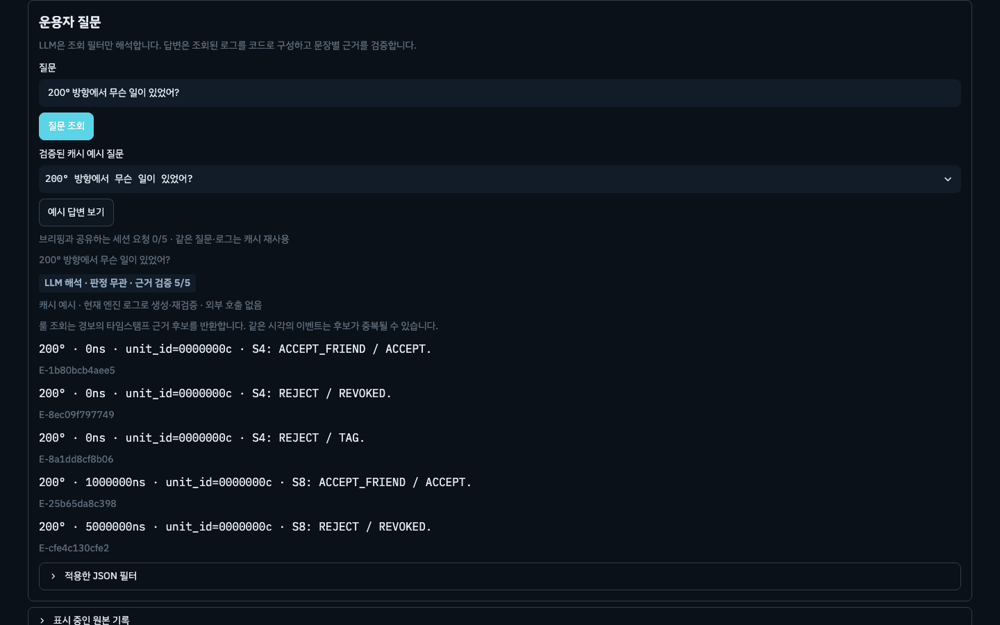

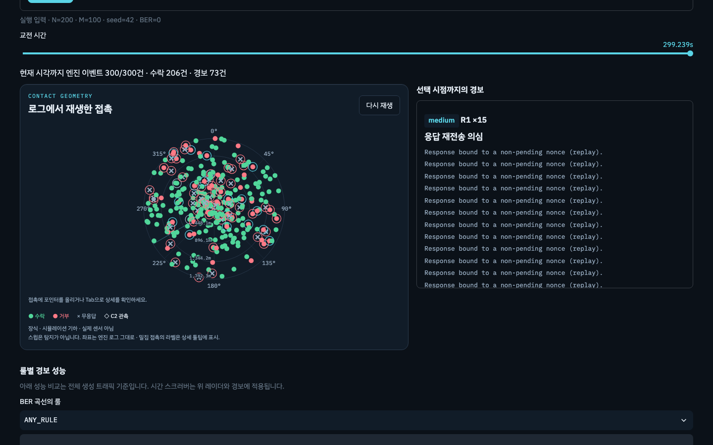

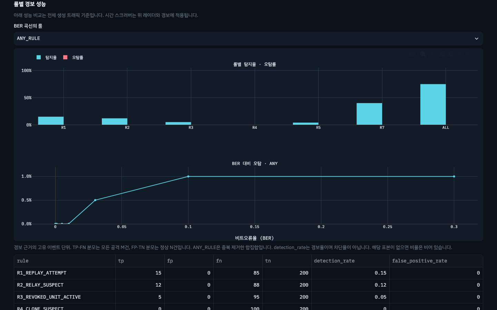

[390px 모바일 첫 화면](docs/img/visual-d-mobile-first.png) · [모바일 성능 차트](docs/img/phase5-mobile-metrics.png)
· [Phase별 PASS/FAIL 검증 기록](docs/upgrade-qa.md)
· [시각 고도화 A–E 검증 기록](docs/visual-upgrade-qa.md)

데모 재녹화: 로컬 Streamlit을 8502 포트에서 실행한 뒤 `python3 scripts/record_walkthrough.py`.
기존 QA 환경의 Playwright와 Chromium을 사용하며 앱 의존성은 추가하지 않습니다.

## Quickstart

저장소 루트에서 실행합니다.

```bash
python3 -m pip install -r requirements.txt
python3 -m pytest -q
python3 scripts/run_all.py --seed 42
python3 -m streamlit run app.py
```

한계 분석 자료는 `python3 scripts/sweep_noise.py`로 생성합니다.
시나리오 실행 결과는 `out/events.jsonl`, `out/summary.csv`에 저장됩니다.

## 공격자 비용

아래는 기본 설정에서 `python3 scripts/sweep_noise.py`로 생성한
`attacker_cost` 데이터입니다. 확률은 명시된 조건 아래의 값이며, 실측 운용 비용은 미측정입니다.
출처의 CSV 파일은 `out/`에 생성됩니다. [유도와 출처 상세](docs/attacker_cost.md)

| 공격 | 조건 | 성공 확률 | 필요 역량 | 유효 시간 | 출처 |
|---|---|---:|---|---|---|
| S2 재전송 | 이미 소비된 nonce | 0 | 이전 응답을 관측·저장하고 재송신할 역량 | 소비된 nonce의 유효 시간은 0초; 미소비 질의의 시간 제한은 미측정(TTL 미구현) | iff/config.py:NONCE_BYTES; iff/protocol.py:Interrogator.verify NONCE; iff/scenarios.py:s2_replay |
| S3 중계 MITM | 추가 지연 0µs | 1 | 질의를 아군에 전달하고 유효 응답을 낮은 지연으로 중계할 역량 | 미측정: 새 nonce 질의에 대한 응답 시간 창(TTL 미구현) | relay_sweep.csv:relay_overhead_ns,reject_rate,budget_ns,nominal_rtt_ns; scripts/sweep_noise.py:relay_sweep; iff/config.py:rtt_budget_ns |
| S3 중계 MITM | 추가 지연 10µs | 1 | 질의를 아군에 전달하고 유효 응답을 낮은 지연으로 중계할 역량 | 미측정: 새 nonce 질의에 대한 응답 시간 창(TTL 미구현) | relay_sweep.csv:relay_overhead_ns,reject_rate,budget_ns,nominal_rtt_ns; scripts/sweep_noise.py:relay_sweep; iff/config.py:rtt_budget_ns |
| S3 중계 MITM | 추가 지연 20µs | 1 | 질의를 아군에 전달하고 유효 응답을 낮은 지연으로 중계할 역량 | 미측정: 새 nonce 질의에 대한 응답 시간 창(TTL 미구현) | relay_sweep.csv:relay_overhead_ns,reject_rate,budget_ns,nominal_rtt_ns; scripts/sweep_noise.py:relay_sweep; iff/config.py:rtt_budget_ns |
| S3 중계 MITM | 추가 지연 30µs | 0.595 | 질의를 아군에 전달하고 유효 응답을 낮은 지연으로 중계할 역량 | 미측정: 새 nonce 질의에 대한 응답 시간 창(TTL 미구현) | relay_sweep.csv:relay_overhead_ns,reject_rate,budget_ns,nominal_rtt_ns; scripts/sweep_noise.py:relay_sweep; iff/config.py:rtt_budget_ns |
| S3 중계 MITM | 추가 지연 40µs | 0 | 질의를 아군에 전달하고 유효 응답을 낮은 지연으로 중계할 역량 | 미측정: 새 nonce 질의에 대한 응답 시간 창(TTL 미구현) | relay_sweep.csv:relay_overhead_ns,reject_rate,budget_ns,nominal_rtt_ns; scripts/sweep_noise.py:relay_sweep; iff/config.py:rtt_budget_ns |
| S3 중계 MITM | 추가 지연 60µs | 0 | 질의를 아군에 전달하고 유효 응답을 낮은 지연으로 중계할 역량 | 미측정: 새 nonce 질의에 대한 응답 시간 창(TTL 미구현) | relay_sweep.csv:relay_overhead_ns,reject_rate,budget_ns,nominal_rtt_ns; scripts/sweep_noise.py:relay_sweep; iff/config.py:rtt_budget_ns |
| S3 중계 MITM | 추가 지연 100µs | 0 | 질의를 아군에 전달하고 유효 응답을 낮은 지연으로 중계할 역량 | 미측정: 새 nonce 질의에 대한 응답 시간 창(TTL 미구현) | relay_sweep.csv:relay_overhead_ns,reject_rate,budget_ns,nominal_rtt_ns; scripts/sweep_noise.py:relay_sweep; iff/config.py:rtt_budget_ns |
| S3 중계 MITM | 추가 지연 200µs | 0 | 질의를 아군에 전달하고 유효 응답을 낮은 지연으로 중계할 역량 | 미측정: 새 nonce 질의에 대한 응답 시간 창(TTL 미구현) | relay_sweep.csv:relay_overhead_ns,reject_rate,budget_ns,nominal_rtt_ns; scripts/sweep_noise.py:relay_sweep; iff/config.py:rtt_budget_ns |
| S4 포획 기체 | 폐기 전·현재/유예 epoch | 1 | 해당 기체의 유효 epoch/unit 키 확보 및 정상 응답 생성 역량 | 폐기 시 즉시 무효; 폐기 없으면 현재+유예(1) epoch까지 유효, 최대 약 2×EPOCH_SECONDS = 1,200초 | iff/config.py:EPOCH_SECONDS,EPOCH_GRACE; iff/protocol.py:Interrogator.verify EPOCH/REVOKED/TAG; iff/scenarios.py:s8_captured_key_grace |
| S4 포획 기체 | 폐기 후 | 0 | 해당 기체의 유효 epoch/unit 키 확보 및 정상 응답 생성 역량 | 폐기 시 즉시 무효; 폐기 없으면 현재+유예(1) epoch까지 유효, 최대 약 2×EPOCH_SECONDS = 1,200초 | iff/config.py:EPOCH_SECONDS,EPOCH_GRACE; iff/protocol.py:Interrogator.verify EPOCH/REVOKED/TAG; iff/scenarios.py:s8_captured_key_grace |
| S5 무작위 위조 | 시도당 균등 태그 추측 | 2.3283064e-10 | 공개 질의 nonce를 수신하고 형식에 맞는 응답·무작위 태그를 송신할 역량 | 미측정: 미소비 nonce 질의 동안 시도(TTL·시도 빈도 미구현) | iff/config.py:TAG_BITS; iff/crypto.py:response_tag; iff/attacks.py:forge |
| S6 기동 재현 | 편대 1대 | 0.0020904541 | 이전 기동을 관측·기록하고 비트 패턴에 대응하는 미세 기동을 재현할 역량 | 현재 패턴 window의 남은 시간 ≤ 60초; 다음 window는 새 패턴 | list_size.csv:fleet_size,analytic_any_false_match,per_unit_prob; iff/maneuver.py:random_match_prob; iff/config.py:MANEUVER_BITS,MANEUVER_HAMMING_K,MANEUVER_WINDOW_S |
| S6 기동 재현 | 편대 5대 | 0.010408662 | 이전 기동을 관측·기록하고 비트 패턴에 대응하는 미세 기동을 재현할 역량 | 현재 패턴 window의 남은 시간 ≤ 60초; 다음 window는 새 패턴 | list_size.csv:fleet_size,analytic_any_false_match,per_unit_prob; iff/maneuver.py:random_match_prob; iff/config.py:MANEUVER_BITS,MANEUVER_HAMMING_K,MANEUVER_WINDOW_S |
| S6 기동 재현 | 편대 10대 | 0.020708983 | 이전 기동을 관측·기록하고 비트 패턴에 대응하는 미세 기동을 재현할 역량 | 현재 패턴 window의 남은 시간 ≤ 60초; 다음 window는 새 패턴 | list_size.csv:fleet_size,analytic_any_false_match,per_unit_prob; iff/maneuver.py:random_match_prob; iff/config.py:MANEUVER_BITS,MANEUVER_HAMMING_K,MANEUVER_WINDOW_S |
| S6 기동 재현 | 편대 25대 | 0.050971125 | 이전 기동을 관측·기록하고 비트 패턴에 대응하는 미세 기동을 재현할 역량 | 현재 패턴 window의 남은 시간 ≤ 60초; 다음 window는 새 패턴 | list_size.csv:fleet_size,analytic_any_false_match,per_unit_prob; iff/maneuver.py:random_match_prob; iff/config.py:MANEUVER_BITS,MANEUVER_HAMMING_K,MANEUVER_WINDOW_S |
| S6 기동 재현 | 편대 50대 | 0.099344194 | 이전 기동을 관측·기록하고 비트 패턴에 대응하는 미세 기동을 재현할 역량 | 현재 패턴 window의 남은 시간 ≤ 60초; 다음 window는 새 패턴 | list_size.csv:fleet_size,analytic_any_false_match,per_unit_prob; iff/maneuver.py:random_match_prob; iff/config.py:MANEUVER_BITS,MANEUVER_HAMMING_K,MANEUVER_WINDOW_S |
| S6 기동 재현 | 편대 100대 | 0.18881912 | 이전 기동을 관측·기록하고 비트 패턴에 대응하는 미세 기동을 재현할 역량 | 현재 패턴 window의 남은 시간 ≤ 60초; 다음 window는 새 패턴 | list_size.csv:fleet_size,analytic_any_false_match,per_unit_prob; iff/maneuver.py:random_match_prob; iff/config.py:MANEUVER_BITS,MANEUVER_HAMMING_K,MANEUVER_WINDOW_S |
| S6 기동 재현 | 편대 200대 | 0.34198558 | 이전 기동을 관측·기록하고 비트 패턴에 대응하는 미세 기동을 재현할 역량 | 현재 패턴 window의 남은 시간 ≤ 60초; 다음 window는 새 패턴 | list_size.csv:fleet_size,analytic_any_false_match,per_unit_prob; iff/maneuver.py:random_match_prob; iff/config.py:MANEUVER_BITS,MANEUVER_HAMMING_K,MANEUVER_WINDOW_S |

S4의 폐기 전 1은 유효 키·새 nonce·허용 RTT를 모두 갖춘 조건부 수락입니다.
S3은 기준 거리 400m, 시드 42, 지연별 200회 시뮬레이션이며 단일 종합 성공률은 미측정입니다.
S6은 독립·균등 패턴 가정의 해석적 오수락이며, 특정 재현 실험의 성공률이 아닙니다.
유도할 근거가 없는 값은 미측정이며 0을 뜻하지 않습니다.

## 가정과 한계

<!-- experiment-limits -->

### 샌드박스에서 확인하는 알려진 한계

중계가 RTT 예산 안에 들어오거나, 포획 키가 아직 폐기되지 않은 현재·유예 epoch이면
공격도 `ACCEPT_FRIEND`가 됩니다. 샌드박스는 이를 **방어 실패 — 알려진 한계**로 표시합니다.
경보가 있더라도 인증 수락을 취소하지 않습니다. 포획 후 2epoch가 지나면 EPOCH가 먼저
실패하므로 폐기 여부를 켜도 REVOKED가 아닌 EPOCH가 기록됩니다(기존 검증 순서).

<!-- experiment-limits -->

**측정하지 않은 가정값** ([iff/config.py](iff/config.py))

- `ASSUMPTION_PROC_NS = 50 µs`: 응답기 처리 지연.
- `ASSUMPTION_PROC_JITTER_NS = 5 µs`: 처리 지연 지터.
- `ASSUMPTION_PROC_MAX_NS = 70 µs`: RTT 검증에 허용한 처리 성분.

**설계상 한계**

- **거리 검증**: 기본 중계 분석의 명목 탐지 경계는 RTT 예산 − 기본 왕복 ≈ 30.674µs
  (약 31µs)입니다. 명목 경계는 지터와 무관하며 경계 주변 성공률은 지터의 영향을 받습니다.
  `out/relay_sweep.csv`의 지연별 성공률은 `1 − reject_rate`입니다.
- **포획 키 유효 구간**: 폐기하면 즉시 무효입니다. 폐기하지 않으면 현재와 유예
  (`EPOCH_GRACE=1`) epoch까지, 최대 약 `2×EPOCH_SECONDS = 1,200초` 동안 유효합니다.
  해당 epoch 키만 보유하고 새 키를 받지 않으며 epoch가 정상 회전한다는 조건입니다.
  코드는 벽시계로 epoch를 자동 회전시키지 않습니다. S4의 TAG 거부는 새 epoch를
  주장하며 옛 키로 서명한 경우입니다. 이전 epoch를 제시하는 유예 수락과 즉시 폐기는 S8에서 확인합니다.
- **C2 목록 크기**: C2는 관측을 아군 목록 전체와 대조하므로 목록이 커질수록
  오수락 확률이 올라갑니다(`out/list_size.csv`). C2 단독 식별은 소규모 편대를
  전제로 하며 대규모·고신뢰 식별에는 C1 확인이 필요합니다.
- **C2 노이즈 민감도**: 관측 σ가 커지면 정상 아군 수락률이 떨어집니다(`out/roc.csv`).
  이전 window 재현의 거부는 S6의 조건에서 확인하는 결과이며, 모든 노이즈 조건에서의 거부를 보장하지 않습니다.
- **상관 룰의 집계 범위**: 시간창 상관 룰 R5·R6·R8은 룰별로 실행당 첫 유효 시간창만
  경보하므로 긴 트래픽에서는 이후 버스트를 놓칠 수 있습니다. 회귀 호환을 위해 유지합니다.
  R6·R8은 기본 실행에 포함되지 않는 예시입니다. R4는 시간창 룰이 아니라 동일 그룹의
  모든 유효 이벤트 쌍을 검사하는 룰이므로 이 제한에 해당하지 않습니다.
- 광학·음향 채널의 물리 계층은 모델링하지 않았습니다. 프로토콜은 채널 독립적입니다.

## S9 상호 인증 확장

기존 S1~S8 판정과 응답 검증 명세는 유지합니다. `Interrogator.issue()`는
`iq_key = HKDF(epoch_key, b"iff-iq", b"")`로 파생한 키로
`iq_tag = trunc32(HMAC-SHA256(iq_key, b"CQ" ‖ nonce ‖ interrogator_id ‖ epoch))`를
자동 첨부합니다. ID는 UTF-8, epoch는 8바이트 big-endian입니다. 태그로 **질의 +4바이트**입니다.
드론에는 해당 epoch의 iq_key와 자신의 unit_key만 배포합니다.

응답기는 현재 epoch만 허용하며(질의에는 유예 없음), 태그 불일치·epoch 범위 밖·
같은 epoch의 이미 처리한 nonce에서 무응답입니다. `CQ` 응답기 로컬 이벤트로
`NO_RESPONSE`와 `IQ_TAG` / `IQ_EPOCH` / `IQ_NONCE` 원인을 기록합니다.
이 기록은 무선 응답이 아니며, 대시보드에서 회색 X와 무응답 피드로 표시합니다.

| 시나리오 | 입력 | 기대 결과 |
|---|---|---|
| S9a | 키 없는 가짜 질의기 | NO_RESPONSE / IQ_TAG |
| S9b | 같은 드론이 처리한 진짜 질의 재방송 | NO_RESPONSE / IQ_NONCE |

R7은 `rules/07-rogue-interrogator.yaml`만으로 이 무응답 기록을 탐지합니다.
CLI와 대시보드는 S9를 포함합니다. 기존 API의 기본 실행 집합은 보존하며,
`run_all(include_grace=True, include_rogue=True)`로 S1~S9를 실행합니다.

| 공격자 비용 | 성공 확률 | 필요 역량 | 한계 |
|---|---:|---|---|
| S9a 질의 태그 추측 | 시도당 2^-32 | 질의 송신과 균등 32비트 태그 추측 | 반복 시도 빈도 미측정 |
| S9b 소비한 질의 재방송 | 0 | 진짜 질의 녹화·재송신 | 같은 응답기·epoch·보존된 nonce 캐시 조건 |

**포획 드론에서 iq_key 유출 시 해당 epoch 동안 가짜 질의가 가능합니다.**
공유 iq_key 폐기·교체와 다음 epoch 키 배포 제외로 제한해야 합니다.
unit ID 폐기만으로 공유 질의 키를 무효화할 수는 없습니다.
nonce 캐시는 프로세스 메모리에 있으므로 재시작 시의 영속 보존은 운용 계층 책임입니다.
응답기가 처음 보는 녹화 질의는 캐시만으로 구분할 수 없습니다.

## 해커톤 기간 신규 개발 범위

프로토콜, 검증 파이프라인, 채널·기동 모델, 공격 시나리오, 탐지 룰, 대시보드,
테스트를 본 해커톤 기간에 신규 개발했습니다. 기존 코드·사전 작업물은 없습니다.

[MIT License](LICENSE) · [시연 안내](DEMO.md)

## LLM 경보 브리핑

운용자 콘솔의 이벤트 피드 아래 **상황 브리핑**은 기존 경보를 해석합니다.
**LLM은 판정에 관여하지 않는다.** 식별·룰 엔진·시나리오·기대값에는 연결되지 않으며,
이벤트 ID, unit_id, reject_stage, 경보 룰과 심각도만 JSON으로 전송합니다.
[OpenAI Structured Outputs](https://developers.openai.com/api/docs/guides/structured-outputs?api-mode=chat)로
`{summary, findings:[{text, evidence_event_ids, rule}], recommendations:[...]}` 응답을 받습니다.

Streamlit Community Cloud의 앱 Settings → Secrets 또는 로컬 `.streamlit/secrets.toml`에 설정하세요.
아래 키 값은 설명용 자리표시자입니다. 실제 키를 소스나 커밋에 넣지 마세요.

```toml
OPENAI_API_KEY = "YOUR_API_KEY"
OPENAI_MODEL = "gpt-4o-mini"
```

동일 이름의 환경변수도 지원하며 Secrets가 우선합니다. 모델 기본값은 `gpt-4o-mini`입니다.
키와 `.env` 파일은 gitignore 대상입니다. 키는 캐시 인자나 로그에 기록하지 않습니다.
컨텍스트 SHA-256 해시와 모델별 `st.cache_data` 메모리 캐시(최대 128개)를 사용합니다.
같은 컨텍스트는 캐시 유지 중 재호출하지 않으며, 실패 결과도 캐시합니다.
실제 호출은 **브리핑 생성** 버튼으로만 요청합니다. 초기 화면은 로컬 예시만 표시합니다.
기존 콘솔·샌드박스·운용자 질문이 세션당 새 외부 요청 **5회**를 공유하며 실패도 횟수에 포함합니다.
세션 캐시 재조회는 횟수를 쓰지 않습니다. 이 제한은 세션 단위이며 서버 전체 비용 한도가 아닙니다.
모델 변경·캐시 초기화·서버 재시작·캐시 항목 퇴출 후에는 다시 호출될 수 있습니다.

각 finding의 이벤트 ID·실제 경보 룰·텍스트 속 unit_id를 결정론적으로 검사합니다.
기체 언급은 `unit_id=<ID>` 형식을 사용하며 8자리 hex 단독 언급도 검사합니다.
실패한 finding은 **근거 없음**과 회색 취소선으로 표시됩니다. 근거 ID를 누르면 기존 상세 패널이 선택됩니다.
검증 n/m은 참조 존재 여부이며 해석의 의미적 정확성 보증은 아닙니다. 요약·권고는 집계 밖입니다.
기존 경보 근거가 타임스탬프이므로 중복 시각은 복수 이벤트 후보로 전달됩니다.

키가 없거나 API 호출·응답 검증이 실패하면 `docs/sample_brief.json`을 **캐시된 예시**로 표시합니다.
이는 seed=42 전체 로그에서 오프라인으로 생성한 예시이며 실시간 LLM 응답으로 가장하지 않습니다.
예시도 현재 표시 로그로 재검증하므로 다른 시나리오나 시드에서는 근거 없음이 표시될 수 있습니다.
생성·검증은 네트워크 없이 재현됩니다:

```bash
python3 scripts/make_sample_brief.py
python3 -m pytest -q
```

## 근거 검증형 운용자 질문

콘솔 아래 **운용자 질문 → 질문 조회**를 누를 때만 LLM을 호출합니다.
LLM에는 질문만 전달하며 방위 범위·시간(ns)·unit_id·판정·룰로 제한된 JSON 필터를 받습니다.
추가 필드, 허용되지 않은 판정/룰, 잘못된 범위는 Pydantic 스키마에서 거부합니다.
북쪽을 가로지르는 방위 범위는 `bearing_min > bearing_max`로 표현합니다.
**적용한 JSON 필터**를 펼쳐 해석된 조회 조건을 확인할 수 있습니다.

조회는 코드가 현재 표시 로그에 수행합니다. 답변은 조회된 이벤트의 원본 사실만으로
구성하며, 모든 문장에 안정적인 이벤트 ID가 붙습니다. 검증기는 인용 ID가 조회 범위 안에 있는지와
문장이 원본 이벤트의 정규 문장과 정확히 같은지를 다시 검사합니다.
없는 ID·필터 밖 ID·변형된 문장은 **근거 없음**과 회색 취소선으로 표시합니다.
필터의 질문 해석 자체가 정확하다는 보증은 아니므로 필터를 함께 확인하세요.
룰 조회는 기존 경보의 타임스탬프 근거를 사용해 같은 시각의 복수 후보가 포함될 수 있습니다.

세 예시 질문은 **200° 방향**, **폐기 기체 활동**, **가짜 질의기 무응답**입니다.
키가 없어도 현재 엔진 로그에서 답변을 생성해 세션 캐시에 보관하고 재검증합니다.
**예시 답변 보기**는 키 유무와 무관하게 외부 호출하지 않습니다.
새 질문은 브리핑과 호출 한도를 공유하며 같은 질문·로그·모델의 캐시는 한도를 소비하지 않습니다.
질의응답 출력은 인증 판정이나 탐지 룰의 입력이 되지 않습니다.

## 레드팀 샌드박스와 교전 트래픽

상단 **작업 공간 → 공격 실험**에서 **레드팀 샌드박스 / 교전 트래픽 / 샌드박스 심화**를 엽니다.
기본 작업 공간의 기존 5개 탭은 유지합니다.
샌드박스는 재전송·중계·무작위 위조·포획 기체·가짜 질의기·질의 재방송·정상 아군을
선택하고 지연(0~200µs), 경과 epoch(0/1/2), 폐기, BER, 시드를 입력한 뒤 **공격 실행**합니다.
판정은 기존 `Interrogator.verify` / `Responder.respond`가 담당합니다. 6단계 상태, RTT,
경보는 엔진 결과만 표시하고, 무응답이나 RTT 이전 거부에는 RTT 숫자를 만들지 않습니다.
무작위 위조는 재현 가능한 시드 RNG로 태그를 구성하고 기존 검증기에 제출합니다.
BER은 응답 태그에 적용하며 질의 인증 태그의 채널 손상은 이 실험 범위에 포함하지 않습니다.

네 프리셋은 클릭 즉시 엔진을 실행합니다. 중계에는 지연, 포획에는 epoch·폐기 입력만 나타나며
BER·시드는 항상 표시됩니다. **샌드박스 심화**에서는 지연 슬라이더의 현재점을 엔진 sweep에 겹쳐 보고,
폐기 시점에 따른 포획 타임라인과 두 설정의 6단계 결과를 비교합니다.
경계선은 같은 시드의 **RTT 예산 − 기본 왕복 시간**이며 지터를 포함합니다.
한계 분석의 지터 없는 명목 경계와 구분됩니다.

다음은 seed=42, 거리 400m, BER=0에서 각 1회 실행한 결과입니다. 단일 실행은 성공 확률 추정이 아닙니다.

| 공격 조건 | 엔진 결과 | 검증 RTT |
|---|---|---:|
| 중계 25µs | ACCEPT_FRIEND · 방어 실패 | 79.214µs |
| 중계 40µs | REJECT / RTT | 94.214µs |
| 포획 1epoch, 미폐기 | ACCEPT_FRIEND · 방어 실패 | 54.214µs |
| 포획 1epoch, 폐기 | REJECT / REVOKED | 미도달 |
| 포획 2epoch, 미폐기 | REJECT / EPOCH | 미도달 |
| 가짜 질의기 | NO_RESPONSE / IQ_TAG | 미도달 |
| 질의 재방송 | NO_RESPONSE / IQ_NONCE | 미도달 |

교전 트래픽 탭은 정상 N건과 공격 M건을 무작위 방위·거리·시각에 섞어 레이더,
룰별 TP/FP/FN/TN 및 BER 오탐 곡선으로 표시합니다. 생성기는 정답을 `truth.jsonl`에만 저장합니다.
첫 진입에는 기본 입력으로 엔진을 실행합니다. **교전 시간**을 움직이면 해당 시점까지의
이벤트를 누적 표시하고, 그 접두 로그로 탐지기를 다시 실행해 경보를 표시합니다.
룰별 탐지율·오탐률 막대와 BER 곡선은 전체 생성 표본 기준이며 시간 선택과 구분해 표시합니다.
탐지 함수에는 라벨 없는 `Event`만 전달하고 경보가 나온 뒤 타임스탬프로 정답과 결합합니다.
이벤트마다 고유 unit ID를 배정하므로 서로 다른 정상 기체를 동일 키 복제로 만들지 않습니다.
현재 생성기는 위 6종 공격을 균등 무작위 추출하며 C2·복제 공격은 포함하지 않습니다.
따라서 R4의 0은 복제 탐지 능력 측정 결과를 뜻하지 않습니다. R6 추가 예시는 기본 룰에 없습니다.

**지표 정의:** 경보 수가 아닌 경보 근거의 고유 이벤트 수를 셉니다. 각 룰의 양성 분모는
모든 공격 M건이며 TP/(TP+FN)이 **경보율**, FP/(FP+TN)이 경보 오탐률입니다. ANY_RULE은 룰별
근거 합집합이며 중복을 제거합니다. 표본이 없는 클래스의 비율은 미정(null)입니다.
정상 인증 거부율과 경보 오탐률은 다릅니다. R5는 기존 엔진대로 첫 실패 집중 창만 반환합니다.
**차단율**은 공격 중 파이프라인이 REJECT 또는 NO_RESPONSE(무응답)로 거부한 비율입니다.
차단과 경보는 독립적으로 집계하며 겹칠 수 있습니다. 기존 CSV의 `detection_rate`는 경보율입니다.

```bash
python3 scripts/traffic.py --benign 200 --attacks 100 --seed 42 --out out/traffic
```

출력: `events.jsonl`, `truth.jsonl`, `run.json`, `metrics.csv`, `ber_sweep.csv`,
`ber_curve.html`(독립 실행 Plotly 곡선), `sandbox.csv`.
동일 시드·기하·태그 난수로 BER만 변경한 paired sweep입니다. 단조 증가를 강제하지 않습니다.

N=200, M=100, seed=42, BER=0의 실제 실행 결과:

**차단율 94% (94/100), 경보율 75% (75/100)**입니다. 무경보 25%는 다음과 같습니다.

| 공격 유형 | 전체 공격 | 차단됐지만 룰 없음 | 알려진 한계로 통과 | 기타 | 무경보 합계 |
|---|---:|---:|---:|---:|---:|
| 재전송 | 15 | 0 | 0 | 0 | 0 |
| 중계 | 12 | 0 | 0 | 0 | 0 |
| 무작위 위조 | 21 | 18 | 0 | 0 | 18 |
| 포획 기체 | 12 | 3 | 4 | 0 | 7 |
| 가짜 질의기 | 26 | 0 | 0 | 0 | 0 |
| 질의 재방송 | 14 | 0 | 0 | 0 | 0 |
| 합계 | 100 | 21 | 4 | 0 | 25 |

무경보 차단 21건은 TAG 거부 18건과 EPOCH 거부 3건입니다. 알려진 한계로 통과한
무경보 4건은 유효 키를 가진 미폐기 포획 기체입니다. 기타는 두 범주에 속하지 않는 무경보 공격입니다.
전체 공격 대비 각각 21%·4%·0%이며, 무경보 25건 안에서는 84%·16%·0%입니다.
통과한 공격은 총 6건이지만 중계 2건에는 경보가 붙었습니다. 따라서 무경보 25건을 방어 실패로 해석하면 안 됩니다.

| 룰 | TP | FP | FN | 경보율 |
|---|---:|---:|---:|---:|
| R1 | 15 | 0 | 85 | 15% |
| R2 | 12 | 0 | 88 | 12% |
| R3 | 5 | 0 | 95 | 5% |
| R4 | 0 | 0 | 100 | 0% |
| R5 | 4 | 0 | 96 | 4% |
| R7 | 40 | 0 | 60 | 40% |
| ANY_RULE | 75 | 0 | 25 | 75% |

| BER | ANY_RULE TP / FN | FP / 200 | 오탐률 |
|---:|---:|---:|---:|
| 0 | 75 / 25 | 0 | 0% |
| 0.001 | 75 / 25 | 0 | 0% |
| 0.005 | 74 / 26 | 0 | 0% |
| 0.01 | 71 / 29 | 0 | 0% |
| 0.03 | 68 / 32 | 1 | 0.5% |
| 0.1 | 63 / 37 | 2 | 1% |
| 0.3 | 63 / 37 | 2 | 1% |

### 부정적 실험 결과

**R8 가설:** 기준 이벤트의 방위 ±10° 범위에서 10초 이내 `REJECT / TAG`가 5회 이상
발생하면 위조 시도의 집중으로 보고 `R8_FORGERY_BURST`를 경보하면, 기존 룰이 놓친
공격의 경보율을 높일 수 있을 것으로 가정했습니다.
[R8 YAML](examples/rules/08-forgery-burst.yaml)은 예시로만 보관하며 기본 룰에 포함하지 않습니다.

**실험 설정:** `TrafficInput(benign=200, attacks=100, seed=seed, ber=ber)`로
seed 0~99를 각각 실행했습니다. BER 0과 0.1 **각각 30,000건**(정상 20,000건,
공격 10,000건), 두 BER 합계 60,000건입니다. 기존 생성기의 6종 공격 균등 무작위 추출과
방위·거리·시각 분포를 유지했습니다. 각 seed·BER의 동일 이벤트를 기본 R1~R5·R7과
여기에 R8만 추가한 룰 집합에 각각 입력했습니다. R6은 양쪽 모두 제외했습니다.
R8 포함 실험은 임시 룰 폴더에 기본 YAML과 R8 YAML을 복사하고
`detect.run_rules(..., rules_dir=...)`로 실행하므로 기본 실행·대시보드에는 영향을 주지 않습니다.

공격 단위 경보율은 위의 **75%와 같은 정의**인 `ANY_RULE TP / 전체 공격 수`입니다.
`iff.traffic.score`로 경보 evidence의 고유 이벤트 합집합을 집계했습니다.
오탐률은 `FP / 전체 정상 수`입니다. 경보 건수/전체 입력은 별도의 출력 빈도이며,
한 경보에 여러 evidence가 있으므로 공격 단위 경보율과 구분합니다.

| BER | 지표 | R8 미포함 | R8 포함 | 변화 |
|---:|---|---:|---:|---:|
| 0 | 공격 단위 경보율 (TP / 10,000) | 72.01% (7,201건) | 72.01% (7,201건) | 0%p |
| 0 | 정상 이벤트 오탐률 (FP / 20,000) | 0% (0건) | 0% (0건) | 0%p |
| 0 | 경보 건수 / 전체 입력 30,000건 | 23.9567% (7,187건) | 23.9567% (7,187건) | 0%p |
| 0.1 | 공격 단위 경보율 (TP / 10,000) | 56.95% (5,695건) | 57.11% (5,711건) | +0.16%p |
| 0.1 | 정상 이벤트 오탐률 (FP / 20,000) | 1.58% (316건) | 1.83% (366건) | +0.25%p |
| 0.1 | 경보 건수 / 전체 입력 30,000건 | 19.0567% (5,717건) | 19.1000% (5,730건) | +0.0433%p |

seed 42 단독 재계산에서도 BER 0의 공격 단위 경보율은 R8 포함/미포함 모두
75% (75/100), BER 0.1은 모두 63% (63/100)였습니다. 오탐률도 각각 0%와 1%로 같았습니다.
100개 seed를 합산하면 BER 0에서는 R8 경보가 없었고, BER 0.1에서는 R8 경보 13건으로
공격 16건과 정상 50건이 추가 표시되었습니다. 기본 룰의 경보 내용은 두 실험에서 동일했습니다.

**결론:** TAG 거부 단독으로는 위조와 채널 비트오류를 구분할 수 없어 버스트 룰은
이 실험에서 공격 단위 경보율을 거의 올리지 못하고 잡음 환경에서 오탐을 늘립니다.
그래서 R8을 기본 룰에 채택하지 않았습니다. 이 결과는 현재 트래픽 분포와 첫 유효 시간창만
반환하는 집계 방식에서의 관측이며, 모든 버스트를 탐지하는 구현의 성능을 뜻하지 않습니다.

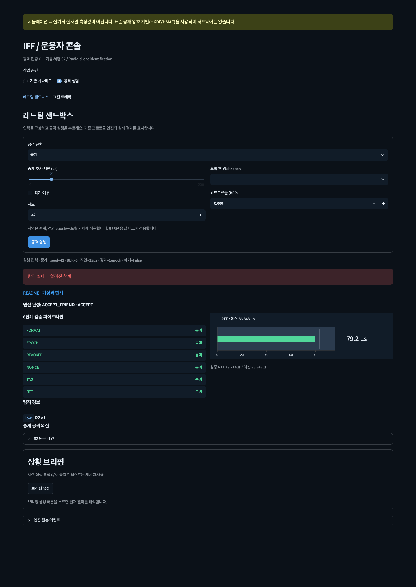
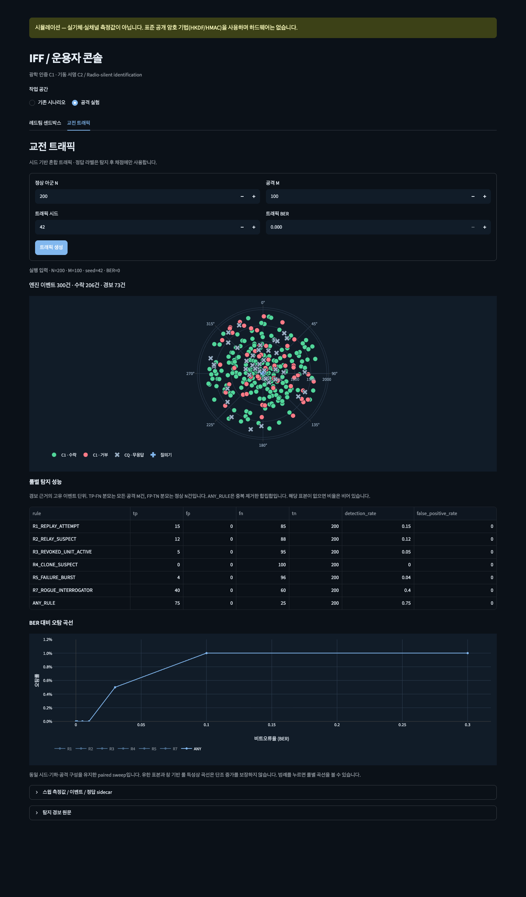
